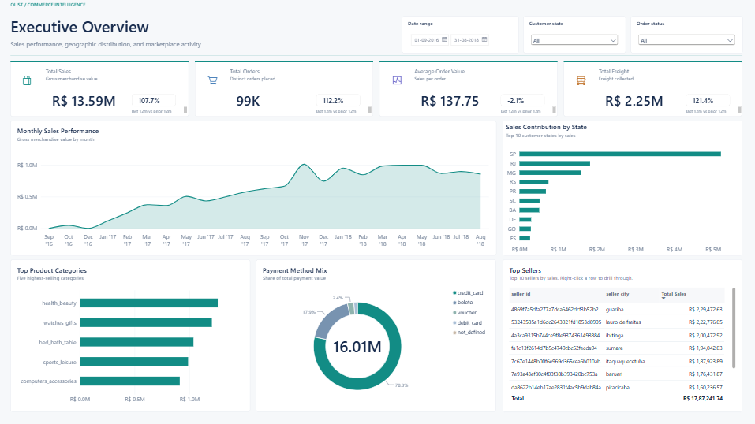
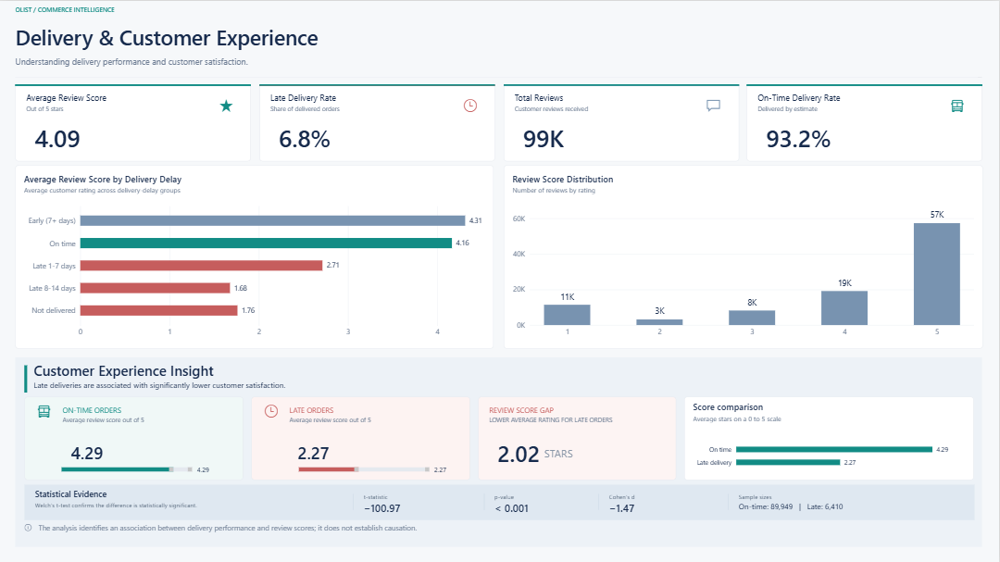
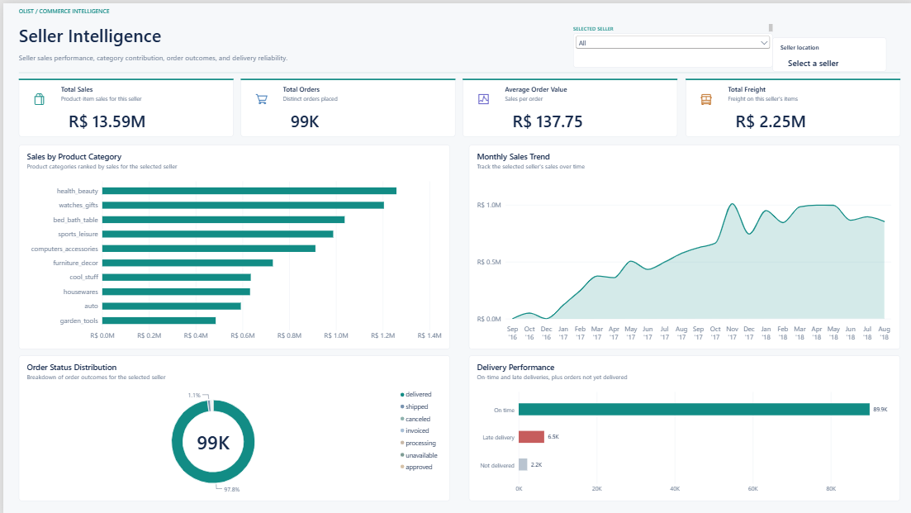

# Olist E-Commerce Analysis: Do Late Deliveries Hurt Customer Reviews?

An end-to-end analysis of 100,000 real marketplace orders from Olist, a Brazilian e-commerce platform. The project cleans nine raw tables with Python, builds a star schema in Power BI, validates the numbers, tests whether late deliveries lower review scores, and lets you drill into any individual seller.


---

## The business question

**Do late deliveries significantly lower customer satisfaction, and how large is the effect?**

## Key findings

| Finding | Result |
|---|---|
| Average review, on-time or early orders | **4.29** out of 5 |
| Average review, late orders | **2.27** out of 5 |
| Gap | **2.02 stars** |
| Welch t-test | t = -100.97, p < 0.001 |
| Effect size (Cohen's d) | -1.47 (a very large effect) |
| Sample sizes | 89,949 on-time or early, 6,410 late |

Late deliveries are strongly associated with lower reviews. Orders that arrive **8 to 14 days late** average only **1.68** stars, compared with **4.16** for on-time orders.

> **Caution:** this is an association, not proof of causation. Only customers who left a review are included, and unhappy customers may be more likely to review.

## Dashboard (3 pages)

| Executive overview | Delivery and customer experience | Seller intelligence |
|---|---|---|
|  |  |  |

**Page 1, Executive overview.** Total sales, orders, average order value and freight, each compared with the prior 12 months. Monthly sales trend, sales by state, top categories, payment mix, and a top-sellers table with drill-through.

**Page 2, Delivery and customer experience.** Review score by delivery-delay group, review score distribution, and a statistical evidence panel with the t-test, p-value, effect size and sample sizes.

**Page 3, Seller intelligence.** Pick a seller (or drill through from the top-sellers table on Page 1) to see that seller's sales, orders, average order value and freight, plus four charts: sales by product category, monthly sales trend, order status distribution, and on-time versus late delivery performance.

## Data

The [Brazilian E-Commerce Public Dataset by Olist](https://www.kaggle.com/datasets/olistbr/brazilian-ecommerce): about 100,000 orders from 2016 to 2018, made at multiple marketplaces in Brazil. It is real, anonymized commercial data, split across nine connected CSV files.

| Table | Rows | Role |
|---|---|---|
| orders | 99,441 | One row per order, with all timestamps |
| order_items | 112,650 | Items per order: price and freight |
| order_payments | 103,886 | Payments per order (split payments exist) |
| order_reviews | 99,224 | Review score and comments |
| customers | 99,441 | Customer location |
| sellers | 3,095 | Seller location |
| products | 32,951 | Product attributes and category |
| geolocation | 1,000,163 | Zip prefix to coordinates |
| category_translation | 71 | Portuguese to English category names |

The raw files are not included in this repository because of their size. Download them from Kaggle and place them in `data/raw/`.

## Data cleaning decisions

Every decision started from an exploration pass over nulls and data types (`scripts/01_explore.py`), then was applied in `scripts/02_clean.py`.

| Problem found | Decision | Why |
|---|---|---|
| Date columns loaded as text | Converted to real datetimes | Needed for delay calculations and time intelligence |
| 2,965 orders have no delivery date | **Kept** them and added an `is_delivered` flag | These are cancelled or undelivered orders, not errors. Dropping them would hide a real business outcome. |
| Delivery delay not in the data | Created `delivery_delay_days` (actual minus estimated delivery date) | Powers the main question. Positive means late. |
| 610 products with no category | Labelled `unknown` instead of dropping | Dropping would remove their sales from the totals |
| Category names in Portuguese | Merged the English translation table | Readable charts |
| Review comments mostly missing (about 59% to 88%) | Treated as "no comment given", not as an error | Most customers give a star rating without writing text |
| Geolocation has 1M rows with many pings per zip | Aggregated to one average coordinate per zip prefix (19,015 rows) | Prevents row duplication when joining |
| Zip prefixes read as numbers | Set to Text in Power Query | Leading zeros would be lost and joins would break |

## Data model

A star schema with order items at the centre.

- **Fact:** `order_items` (price, freight), with `order_payments` as a one-to-many side table.
- **Dimensions:** orders, customers, products, sellers, reviews, and a generated Date table.
- **Role-playing geography:** the geolocation table is duplicated as `customer_geo` and `seller_geo` so each can connect to its own table without creating ambiguous relationships.
- **Customers:** in this dataset `customer_id` is unique per order, so the orders-to-customers relationship is one-to-one. Use `customer_unique_id` to identify repeat buyers.
- **Seller filtering:** `orders` sits on the "one" side of its relationship with `order_items`, so a seller selection does not reach `orders` by default. Measures about order status, delivery and reviews use `CROSSFILTER` to pass the seller filter through, and count distinct orders.

## Validation

A check that the model does not double-count or lose rows:

| Measure | Value |
|---|---|
| Total sales (item prices) | R$ 13.59M |
| Total freight | R$ 2.25M |
| Sales + freight | R$ 15.84M |
| Total payments | R$ 16.01M |
| Gap | about **1.1%** |

Payments are slightly higher than price plus freight, which fits installment interest on card payments. The one-to-many payments table was the main double-counting risk, and this reconciliation confirms the measures are not inflated by it.

## Other insights

- Credit cards account for **78.3%** of payment value.
- São Paulo is the largest state by sales, followed by Rio de Janeiro and Minas Gerais.
- Top categories by sales: health and beauty, watches and gifts, bed, bath and table.
- Monthly sales grew steadily through 2017 and flattened in 2018. The very large last-12-months growth figures (over 100%) compare against a marketplace that was still ramping up in late 2016, so read them with that in mind.

## Limitations

- **Association, not causation.** Late delivery may correlate with other problems, such as product quality or remote locations.
- **Review selection bias.** Only orders with reviews are in the statistical test.
- **Ordinal scores.** Review scores are 1 to 5 ratings. A Welch t-test is a common choice, but a non-parametric check such as Mann-Whitney U would be a good robustness test.
- **Seller attribution.** An order can contain items from more than one seller. On Page 3, an order counts for every seller with at least one item on it, so status and delivery results at seller level share orders across sellers.
- **Anonymized sellers.** Seller IDs are anonymized, so sellers are identified by ID and city, not by name.
- **Data ends in 2018.** The findings describe the period covered, not today's marketplace.

## Project structure

```
olist-analysis/
├── README.md
├── requirements.txt
├── .gitignore
├── data/
│   ├── raw/                  # Kaggle CSVs (not committed)
│   └── cleaned/              # generated (not committed)
├── scripts/
│   ├── 01_explore.py
│   ├── 02_clean.py
│   └── 03_ttest_reviews.py
├── powerbi/
│   ├── olist-analysis.pbip
│   ├── olist-analysis.Report/
│   ├── olist-analysis.SemanticModel/
│   ├── Theme/olist_theme.json
│   └── tools/redesign.py     # report styling helper
└── docs/                     # screenshots
```

## How to reproduce

```bash
pip install -r requirements.txt
python scripts/01_explore.py
python scripts/02_clean.py
python scripts/03_ttest_reviews.py
```

Then open `powerbi/olist-analysis.pbip` in Power BI Desktop. The report and data model are included in their text form; the model reads the CSVs from `data/cleaned/`, so keep that folder in place before refreshing.

## Tech stack

Python (pandas, SciPy), Power BI (Power Query, DAX, data modelling, drill-through), statistics (Welch t-test, Cohen's d).

## Author

**Shashwat Trigunayat** · [GitHub](https://github.com/ShashwaTTrigunayaT) · [LinkedIn](https://www.linkedin.com/in/shashwat-trigunayat-7279342b7/)